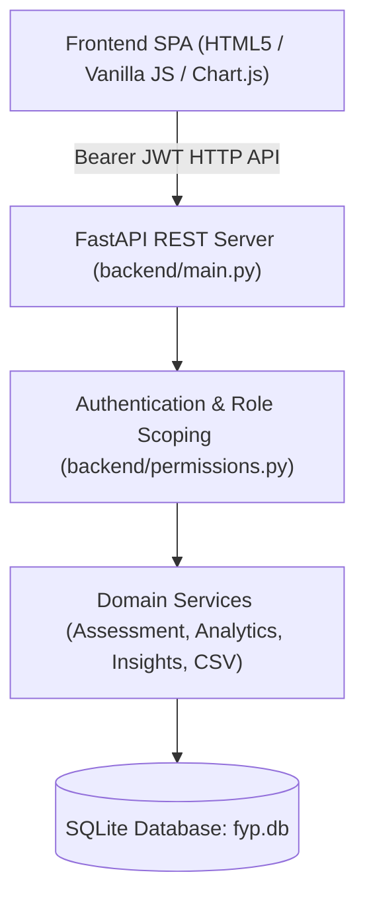

# Student Learning Pattern Analysis
### A Human-Centred Educational Analytics System for Timely Academic Support

[](https://fastapi.tiangolo.com)
[](https://www.python.org/)
[](https://www.sqlite.org/)
[](#)

---

## 1. Project Identity & Research Motivation

**Student Learning Pattern Analysis** is an educational analytics and decision-support platform designed to analyze university students' mid-semester academic performance.

Originally developed as an undergraduate Final Year Project (FYP), this application has been reframed to align with the **Erasmus Mundus Artificial Intelligence and Sustainable Societies (AISS)** programme, demonstrating competencies in responsible educational data engineering, human-centred AI evaluation, and accessible interface design.

### Guiding Research Question
> *"How can educational analytics help instructors understand student learning patterns and identify opportunities for timely academic support without reducing students to predictive labels?"*

Rather than employing black-box predictive models that stamp students with stigmatizing failure labels, the system leverages structured academic data, descriptive analytics, and traceable component-level insights to support human pedagogical decision-making.

---

## 2. Problem Being Addressed

1. **Premature and Cumulative Grading:** Traditional academic systems often evaluate students only at the end of the term, missing the critical window where formative intervention could alter learning outcomes.
2. **Aggregated Marks Obscuring Specific Learning Hurdles:** Collapsing midterm performance into a single aggregate score hides crucial nuances (e.g., a student excelling in written exams but struggling with classroom presentations, or vice versa).
3. **Flawed Predictive Labeling in Educational Tech:** Commercial and research prototypes frequently train machine learning algorithms on heuristic rules, creating circular prediction feedback loops that treat tentative statistical associations as definitive judgements about a learner's potential.
4. **Data Privacy and Lack of Student Transparency:** Students are often excluded from inspecting the granular breakdown of their own academic progress.

---

## 3. Academic Assessment Structure

The platform implements an exact **40-mark mid-semester assessment framework**:

| Assessment Component | Max Marks | Allowable Range | Format & Rules |
|---|:---:|:---:|---|
| **Midterm Examination** | 30 | $0.0 \text{--} 30.0$ | Formal written exam. Nullable. |
| **Assignment** | 3 | $0.0 \text{--} 3.0$ | Coursework submission. Nullable. |
| **Presentation** | 3 | $0.0 \text{--} 3.0$ | Oral communication. Nullable. |
| **Attendance** | 4 | $0.0 \text{--} 4.0$ | Recorded as **marks out of 4**, NOT a percentage. Nullable. |
| **Sessional Marks** | 10 | $0.0 \text{--} 10.0$ | $\text{Assignment} + \text{Presentation} + \text{Attendance}$. Null if any component is missing. |
| **Overall Total** | 40 | $0.0 \text{--} 40.0$ | $\text{Midterm} + \text{Sessional}$. Null if any component is missing. |

### Validation Policies
* Attendance entered as a percentage (e.g., $85\%$) is rejected with an explicit validation error.
* Missing marks remain `NULL`. They are **never treated as zero** or silently modified.
* Total marks are not derived when any component is missing, ensuring incomplete records are clearly flagged.

---

## 4. Key System Features

### A. Professional Teacher Analytics Dashboard
* **Dynamic Database Statistics:** Real-time calculation of total enrolled students, average score, score range (lowest/highest), and count of incomplete records.
* **Score Distribution Chart:** Interactive histogram grouping scores across 4 performance intervals ($0\text{--}19.9$, $20\text{--}27.9$, $28\text{--}34.9$, $35\text{--}40.0$).
* **Component Comparison Chart:** Benchmarks class component averages against maximum obtainable marks.
* **Evidence-Based Support Insights:** Identifies incomplete records, component divergence (e.g., high midterm exam score but low coursework submissions), and attendance concerns.

### B. Read-Only Student Academic Portal
* Direct, transparent access for students to review their own mid-semester marks.
* Visual achievement breakdown across the four components.
* Actionable, non-stigmatizing feedback generated strictly from verified assessment data.
* Strict isolation preventing access to peer records.

### C. System Administration Console
* Teacher account creation and class assignments.
* Section setup and cohort management.
* Student enrollment directory with live search and filtering.

### D. Robust CSV Import & Export Pipeline
* Strict validation of student IDs, names, classes, and component mark boundaries.
* Prevention of accidental data overwrites with batch duplicate detection.
* Detailed import summary reporting successful records, skipped records, and row-by-row error logs.
* Sanitized CSV export strictly scoped to the teacher's assigned classes (excluding passwords and tokens).

---

## 5. Technology Stack

* **Backend:** Python 3.11, FastAPI (modular routers, dependency injection, Pydantic schemas)
* **Database:** SQLite 3 with normalized 6-table relational schema, foreign key enforcement, and query indexing
* **Security & Auth:** Bcrypt password hashing (`passlib`), HMAC-SHA256 JWT tokens (`python-jose`)
* **Data Processing:** Pandas, NumPy
* **Frontend:** HTML5, CSS3, Vanilla JavaScript (ES6+), Chart.js
* **Machine Learning Audit:** Scikit-learn (Stratified Cross-Validation, Random Forest, Dummy Baselines)

---

## 6. Architecture & Relational Schema

### System Architecture


### Relational Database Schema
The database uses a normalized 6-table design:
* `users`: Authentication credentials, roles (`administrator`, `teacher`, `student`), and account status.
* `teachers`: Teacher profiles linked to user logins.
* `classes`: Academic classes, sections, and sessions.
* `students`: Student profiles with unique `student_id` and class foreign key.
* `teacher_classes`: Junction table enforcing teacher-class assignment boundaries.
* `assessment_records`: Mid-semester marks with range check constraints and update timestamps.

For complete schema details and ER diagram, see [`docs/database_schema.md`](file:///c:/Users/hajis/Downloads/Student%20Learning%20Pattern%20Analysis/docs/database_schema.md).

---

## 7. Machine Learning Audit & Critical Evaluation

In the original undergraduate project, a Random Forest classifier achieved $>98\%$ accuracy in classifying students into learning patterns and risk categories.

As part of this reframing, an empirical audit ([`ml/feature_analysis.py`](file:///c:/Users/hajis/Downloads/Student%20Learning%20Pattern%20Analysis/ml/feature_analysis.py)) was conducted, revealing:
1. **$100.0\%$ Circular Target Leakage:** Target labels were mathematically derived from deterministic programmatic if/else rules using GPA, Attendance, and Total Marks. Training a classifier on these exact metrics simply replicated the heuristic rule.
2. **Class Imbalance:** Only 15 records in the cohort were marked at-risk, yielding a 10:1 imbalance where naive majority guessing scores $>90\%$ accuracy.
3. **Ethical Decision:** Automated risk prediction has been removed from the live platform. The application uses **descriptive analytics and evidence-based support insights**, leaving pedagogical intervention decisions in human hands.

For full benchmark tables and methodology, see [`docs/ml_evaluation.md`](file:///c:/Users/hajis/Downloads/Student%20Learning%20Pattern%20Analysis/docs/ml_evaluation.md).

---

## 8. Installation & Setup Instructions

### Prerequisites
* Python 3.11+
* Modern web browser (Chrome, Edge, Firefox, Safari)

### Step 1: Clone or Navigate to Project
```bash
cd "c:\Users\hajis\Downloads\Student Learning Pattern Analysis"
```

### Step 2: Install Dependencies
```bash
pip install -r requirements.txt
```

### Step 3: Initialize Database & Seed Demonstration Data
```bash
python scripts/create_demo_data.py
```
This initializes `fyp.db` and loads 90 realistic demonstration student records across 3 academic classes.

---

## 9. Running the Application

Start the FastAPI application using the runner script:
```bash
python scripts/run.py
```
Or directly with Uvicorn:
```bash
uvicorn backend.main:app --host 127.0.0.1 --port 8000 --reload
```

Open your browser and navigate to:
**[http://127.0.0.1:8000](http://127.0.0.1:8000)**

This will automatically redirect to the login page.

### Demonstration Credentials

| Role | Username | Password | Permitted Scope |
|---|---|---|---|
| **Administrator** | `admin` | `admin123` | Full system access (teachers, classes, students, system CSV) |
| **Teacher 1** | `teacher1` | `teach123` | Dr. Mustafa Hameed (Assigned to `BSIT - Section A` & `BSCS - Section A`) |
| **Teacher 2** | `teacher2` | `teach456` | Ms. Samra Riaz (Assigned to `BSIT - Section B` only) |
| **Student** | `FA22-BIT-A-001` | `student123` | Read-only personal academic breakdown out of 40 |

---

## 10. Running Automated Tests

A comprehensive unit test suite validates assessment math, security permissions, analytics calculations, CSV pipelines, and ML reproducibility:

```bash
# Run all unit tests
python -m unittest discover tests/
```

Individual test suites:
```bash
python -m unittest tests/test_assessments.py   # Boundary validation, marks math (Max 40)
python -m unittest tests/test_auth.py          # Bcrypt hashing, JWT issuance, login endpoint
python -m unittest tests/test_permissions.py   # RBAC scoping, teacher class isolation
python -m unittest tests/test_analytics.py     # Class statistics & support insights
python -m unittest tests/test_csv.py           # CSV import/export validation & security
python -m unittest tests/test_ml.py            # Reproducible ML audit and baseline comparison
```

---

## 11. Project Documentation Index

* [`docs/project_overview.md`](file:///c:/Users/hajis/Downloads/Student%20Learning%20Pattern%20Analysis/docs/project_overview.md): Comprehensive project scope and pedagogical framing.
* [`docs/system_architecture.md`](file:///c:/Users/hajis/Downloads/Student%20Learning%20Pattern%20Analysis/docs/system_architecture.md): System architecture diagrams and component interactions.
* [`docs/database_schema.md`](file:///c:/Users/hajis/Downloads/Student%20Learning%20Pattern%20Analysis/docs/database_schema.md): Database ER diagram and table specifications.
* [`docs/data_dictionary.md`](file:///c:/Users/hajis/Downloads/Student%20Learning%20Pattern%20Analysis/docs/data_dictionary.md): Field-by-field data dictionary.
* [`docs/ml_evaluation.md`](file:///c:/Users/hajis/Downloads/Student%20Learning%20Pattern%20Analysis/docs/ml_evaluation.md): Machine learning audit, feature leakage analysis, and baselines.
* [`docs/privacy_and_ethics.md`](file:///c:/Users/hajis/Downloads/Student%20Learning%20Pattern%20Analysis/docs/privacy_and_ethics.md): Ethics and human-centred analytics framework.
* [`docs/changelog.md`](file:///c:/Users/hajis/Downloads/Student%20Learning%20Pattern%20Analysis/docs/changelog.md): Development history and architectural evolution.
