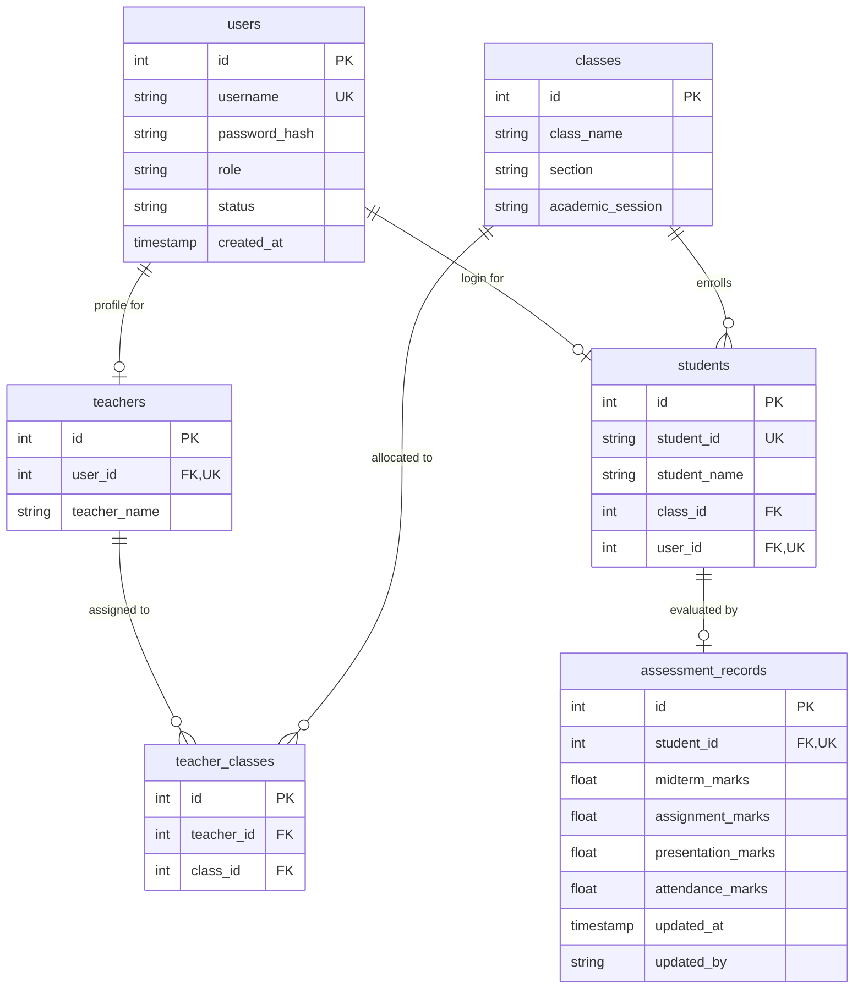

# Database Schema & Entity Relationship Specification
## Student Learning Pattern Analysis

---

## 1. Entity-Relationship (ER) Diagram

The system employs a normalized 6-table relational schema designed to eliminate duplicate personal records, enforce class-teacher assignment boundaries, and maintain assessment integrity.

---

## 2. Table Specifications & Constraints

### 1. `users`
Stores authentication credentials, user roles, and account statuses.
* `id`: `INTEGER PRIMARY KEY AUTOINCREMENT`
* `username`: `TEXT UNIQUE NOT NULL`
* `password_hash`: `TEXT NOT NULL` (Bcrypt hash)
* `role`: `TEXT NOT NULL CHECK(role IN ('administrator', 'teacher', 'student'))`
* `status`: `TEXT DEFAULT 'active' CHECK(status IN ('active', 'inactive', 'suspended'))`
* `created_at`: `TIMESTAMP DEFAULT CURRENT_TIMESTAMP`

### 2. `teachers`
Instructor identity information.
* `id`: `INTEGER PRIMARY KEY AUTOINCREMENT`
* `user_id`: `INTEGER UNIQUE NOT NULL REFERENCES users(id) ON DELETE CASCADE`
* `teacher_name`: `TEXT NOT NULL`

### 3. `classes`
Academic class degree, section, and cohort session.
* `id`: `INTEGER PRIMARY KEY AUTOINCREMENT`
* `class_name`: `TEXT NOT NULL` (e.g., `BSIT`, `BSCS`)
* `section`: `TEXT NOT NULL` (e.g., `Section A`, `Section B`)
* `academic_session`: `TEXT NOT NULL` (e.g., `2025-2026`)
* *Constraint:* `UNIQUE(class_name, section, academic_session)`

### 4. `students`
Student registry linking identity, class enrollment, and user login.
* `id`: `INTEGER PRIMARY KEY AUTOINCREMENT`
* `student_id`: `TEXT UNIQUE NOT NULL` (e.g., `FA22-BIT-A-001`)
* `student_name`: `TEXT NOT NULL`
* `class_id`: `INTEGER NOT NULL REFERENCES classes(id) ON DELETE CASCADE`
* `user_id`: `INTEGER UNIQUE REFERENCES users(id) ON DELETE SET NULL`
* *Index:* `CREATE INDEX idx_students_class ON students(class_id);`

### 5. `teacher_classes`
Junction table controlling which classes each teacher is authorized to access.
* `id`: `INTEGER PRIMARY KEY AUTOINCREMENT`
* `teacher_id`: `INTEGER NOT NULL REFERENCES teachers(id) ON DELETE CASCADE`
* `class_id`: `INTEGER NOT NULL REFERENCES classes(id) ON DELETE CASCADE`
* *Constraint:* `UNIQUE(teacher_id, class_id)`
* *Indexes:* `idx_teacher_classes_teacher`, `idx_teacher_classes_class`

### 6. `assessment_records`
Mid-semester assessment marks for each enrolled student.
* `id`: `INTEGER PRIMARY KEY AUTOINCREMENT`
* `student_id`: `INTEGER UNIQUE NOT NULL REFERENCES students(id) ON DELETE CASCADE`
* `midterm_marks`: `REAL CHECK(midterm_marks IS NULL OR (midterm_marks >= 0 AND midterm_marks <= 30))`
* `assignment_marks`: `REAL CHECK(assignment_marks IS NULL OR (assignment_marks >= 0 AND assignment_marks <= 3))`
* `presentation_marks`: `REAL CHECK(presentation_marks IS NULL OR (presentation_marks >= 0 AND presentation_marks <= 3))`
* `attendance_marks`: `REAL CHECK(attendance_marks IS NULL OR (attendance_marks >= 0 AND attendance_marks <= 4))`
* `updated_at`: `TIMESTAMP DEFAULT CURRENT_TIMESTAMP`
* `updated_by`: `TEXT`
* *Index:* `CREATE INDEX idx_assessment_student ON assessment_records(student_id);`
