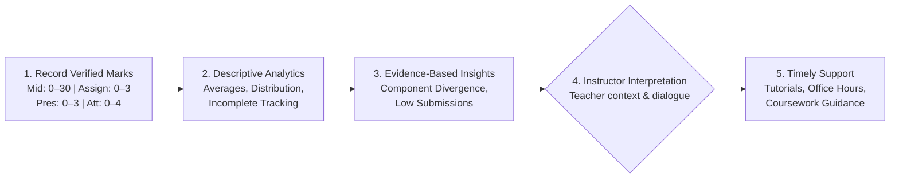

# Privacy, Ethics & Human-Centred Analytics Framework
## Student Learning Pattern Analysis
### Formulated for the Erasmus Mundus Artificial Intelligence and Sustainable Societies (AISS) Programme

---

## 1. Ethical Stance & Portfolio Theme

The deployment of Artificial Intelligence and analytics within higher education presents profound ethical considerations regarding power dynamics, automated bias, and student agency.

The **Student Learning Pattern Analysis** platform adopts a foundational tenet:

> **Educational analytics must support human pedagogical decision-making, not automate academic verdicts or reduce complex individuals to predictive labels.**

The system actively rejects algorithmic paternalism. It treats quantitative assessment data as formative evidence that invites dialogue between instructor and learner, rather than a deterministic forecast of failure.

---

## 2. Core Ethical Principles

### A. Non-Stigmatizing Pedagogical Language
Predictive systems often categorize students under damaging labels such as *"At-Risk"*, *"Weak Student"*, *"Likely to Fail"*, or *"Poor Learner"*. Such labels introduce psychological confirmation bias among teachers and can foster fatalistic disengagement among students.

The system replaces fixed categorical labels with **interpretable, component-specific support insights**:
* Instead of *"High-Risk Student"*, the system surfaces: *"Assessment record is incomplete (missing presentation mark)"* or *"Component divergence detected: student achieved 90% on midterm examination but maintains low coursework submissions"*.
* Insights are framed as actionable invitations for instructor inquiry rather than psychological diagnoses.

### B. Student Agency & The Right to Transparent Progress
Educational transparency requires that students have direct, unmediated access to their own academic evaluation.
* The application provides a dedicated, clean, read-only student dashboard.
* Students can view their exact marks across all four components (Midterm, Assignment, Presentation, Attendance) and review evidence-based feedback on component balance.
* Students are never exposed to ranking against peers or demoralizing automated predictive scores.

### C. Strict Access Isolation & Confidentiality
* **Peer Privacy:** Students are strictly prohibited from viewing the marks, profiles, or totals of other students. Backend permission checks reject cross-student requests with HTTP 403 Forbidden.
* **Teacher Class Scoping:** Instructors are restricted to view and edit marks exclusively for classes assigned to them. They cannot inspect academic records from unassigned sections.
* **Data Sanitization:** CSV downloads and frontend API responses strictly strip passwords, password hashes, and session tokens.

### D. Responsible Demonstration & Synthetic Data
In compliance with international data privacy standards (including GDPR and European educational guidelines), **no real student Personally Identifiable Information (PII) is exposed in public portfolios or live demonstrations**.
* All demonstration records in `data/synthetic/` are synthetically generated with realistic distributions and fictional names.
* Raw historical datasets from the original project are preserved securely in `data/raw/` and excluded from public deployments.

---

## 3. Guiding Pedagogical Workflow

This workflow ensures that the final decision regarding intervention remains entirely with the human educator, supported by accurate, transparent, and defensible academic evidence.
