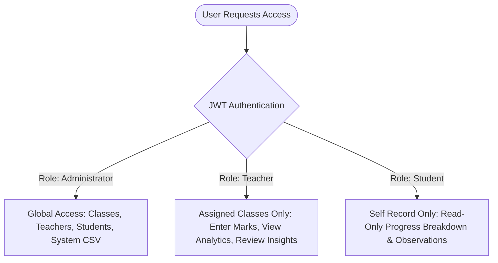

# Project Overview: Student Learning Pattern Analysis
## A Human-Centred Educational Analytics System for Timely Academic Support

---

## 1. Executive Summary

**Student Learning Pattern Analysis** is a data-driven educational analytics application designed to evaluate students' mid-semester academic performance and assist educators in identifying timely opportunities for academic support.

Originally conceived as an undergraduate Final Year Project (FYP), this system has been systematically reframed for the **Erasmus Mundus Artificial Intelligence and Sustainable Societies (AISS)** portfolio. The reframing transitions the project from a reductionist automated prediction paradigm to a **responsible, human-centred decision-support platform**.

---

## 2. Guiding Research Question

> *"How can educational analytics help instructors understand student learning patterns and identify opportunities for timely academic support without reducing students to predictive labels?"*

This guiding question emphasizes that:
1. Analytics should support human pedagogical judgement, not automate academic verdicts.
2. Formative mid-semester data is most valuable when broken down into diagnostic components (Midterm, Assignment, Presentation, Attendance) rather than collapsed into arbitrary risk flags.
3. Educational decision support must remain transparent, interpretable, and traceable directly to verified academic records.

---

## 3. Academic Assessment Structure

The application operates on an exact **40-mark mid-semester assessment model**:

| Assessment Component | Maximum Marks | Input Boundaries | Missing Value Policy |
|---|:---:|:---:|---|
| **Midterm Examination** | 30 | $0.0 \le \text{Mark} \le 30.0$ | Kept as explicit `NULL`. Never assumed zero. |
| **Assignment** | 3 | $0.0 \le \text{Mark} \le 3.0$ | Kept as explicit `NULL`. Never assumed zero. |
| **Presentation** | 3 | $0.0 \le \text{Mark} \le 3.0$ | Kept as explicit `NULL`. Never assumed zero. |
| **Attendance** | 4 | $0.0 \le \text{Mark} \le 4.0$ (marks, NOT %) | Kept as explicit `NULL`. Never assumed zero. |
| **Sessional Marks** | 10 | Derived: $\text{Assign} + \text{Pres} + \text{Att}$ | Calculated only when all 3 sessional components exist. |
| **Total Mid-Semester Score** | 40 | Derived: $\text{Midterm} + \text{Sessional}$ | Calculated only when all 4 components exist. |

---

## 4. User Roles and Security Scoping

The application enforces fine-grained Role-Based Access Control (RBAC) across three distinct user roles:

1. **Administrator**:
   * Create and manage teacher accounts.
   * Manage classes, sections, and academic sessions.
   * Assign teachers to specific classes via `teacher_classes`.
   * Manage student records and global CSV import/export.
2. **Teacher**:
   * Strictly isolated to their assigned classes.
   * Enter, update, and validate mid-semester assessment marks.
   * View class-level descriptive analytics, score distributions, and component comparisons.
   * Review evidence-based support insights and identify incomplete records.
   * Export CSV marksheets for assigned classes only.
3. **Student**:
   * Strictly read-only access.
   * Securely view own academic profile and assessment breakdown out of 40 marks.
   * Read evidence-based progress feedback and component observations.
   * Cannot view other students' records or access teacher/admin features.

---

## 5. Technology Stack

* **Backend Engine:** Python 3.11, FastAPI (Asynchronous REST API, modular routers, Pydantic schemas)
* **Data Processing & Engineering:** Pandas, NumPy
* **Database Architecture:** SQLite with 6-table normalized relational schema, foreign key enforcement, uniqueness constraints, and query indexing.
* **Security & Auth:** Bcrypt password hashing (`passlib`), HMAC-SHA256 JSON Web Tokens (`python-jose`), scoped authorization dependencies.
* **Frontend Application:** Modern Vanilla HTML5, CSS3 with responsive design tokens, Vanilla JavaScript (ES6+), Chart.js for accessible data visualizations.
* **Machine Learning Audit Module:** Scikit-learn (Stratified Cross-Validation, Random Forest, Dummy Baselines, Feature Importance Analysis).
