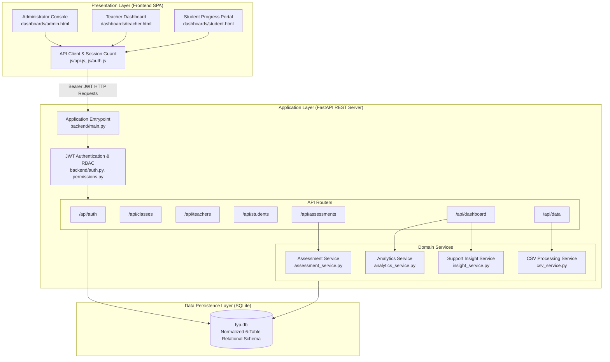

# System Architecture & Technical Design
## Student Learning Pattern Analysis

---

## 1. High-Level Architecture Diagram

The system employs a layered, modular client-server architecture designed for high security, clear separation of concerns, and robust role-based access control.

---

## 2. Request Lifecycle & Authorization Enforcement

1. **Authentication:**
   Users submit credentials to `/api/auth/login`. The backend verifies the bcrypt password hash in `users` and emits a signed JWT token encapsulating the user's ID, username, and assigned role.
2. **Permission Boundary:**
   On every secured endpoint, FastAPI dependencies (`get_current_user`, `require_roles`, `check_teacher_class_access`, `check_student_record_access`) intercept the request:
   * **Teacher Class Scoping:** Queries the `teacher_classes` junction table. If a teacher requests data for a class outside their assigned IDs, HTTP 403 Forbidden is immediately raised.
   * **Student Record Scoping:** Compares `user.student_id` directly against the requested record. Students cannot access other students' profiles or administrative endpoints.
3. **Data Validation:**
   Before any assessment record is saved or updated, marks are validated against the exact mid-semester bounds ($0\text{--}30$ Midterm, $0\text{--}3$ Assignment, $0\text{--}3$ Presentation, $0\text{--}4$ Attendance).
4. **Descriptive Analytics & Traceable Insights:**
   Dashboard calculations are performed on-the-fly from live SQL queries, ensuring that no statistics are hardcoded and that missing components are accurately distinguished from zero marks.
